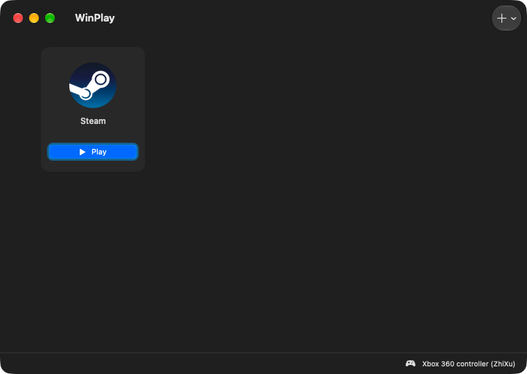
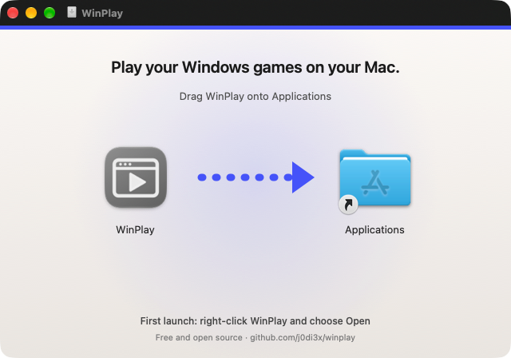

# WinPlay

<p align="center"><a href="https://ko-fi.com/j0di3x"></a></p>

Play Windows games, and run Windows apps, on an Apple silicon Mac. WinPlay is a small native macOS
app around Wine and Apple's **Game Porting Toolkit 4** (D3DMetal), so DirectX 11 and 12 games run
on Metal. Each game gets its own Windows setup, so one broken install never affects the others.

<p align="center"></p>

> Unofficial. Not affiliated with Microsoft, Apple, Valve or GameHub. This repository contains no
> Wine build, no Apple software and no games.

## Features

- **Library:** your games and apps as tiles with their real icons; Play, Stop, double-click to start
- **Add anything:** point at a game's `.exe` (portable games, games on an external drive), or run
  a Windows installer (`setup.exe` / `.msi`)
- **Finds new programs:** whenever an installer, a game launcher or Steam closes, WinPlay looks in
  that bottle's `Program Files` and `Program Files (x86)` for new `.exe` files and asks which ones
  to add to the library. Right-click a tile → *Look for new programs* to check by hand
- **Opens Windows files:** double-click an `.exe`, `.msi`, `.bat` or `.cmd` in Finder (or use
  *Open With → WinPlay*). Installers run in a new bottle; a game's `.exe` gets its own tile and
  starts. *WinPlay → Open Windows Programs with WinPlay* makes it the default app for these files
- **Steam:** one click installs the Windows Steam client into its own bottle, so you can sign in and
  play your Steam library
- **One bottle per game:** a clean Windows 10 setup cloned in under a second (APFS clones, so it
  takes almost no disk space until the game writes to it)
- **Per-game settings:** launch options, Windows version (XP to 11), Apple D3DMetal on/off, Metal 4,
  FPS counter (Metal HUD)
- **Keep or delete the bottle:** when you remove a game, choose whether its bottle (its sandbox,
  with saves and settings) goes to the Trash or stays. Kept games come back from
  *Add → Removed games*
- **Fixes:** Visual C++ runtimes in one click, Wine settings, open the C: drive, open the last log
- **Controllers:** the footer shows the connected controller or wheel
- **13 languages:** English, Deutsch, Español (España), Español (Latinoamérica), Français, 日本語,
  한국어, Polski, Português (Brasil), Português (Portugal), Русский, 简体中文, 繁體中文

## Requirements

- Mac with Apple silicon, macOS 14 or newer (tested on macOS 27.2, M4 Pro)
- **Wine** with Apple's D3DMetal hooks. WinPlay imports it from
  [BeamNG Launcher](https://github.com/j0di3x/beamng-mac-launcher) or from **GameHub** (install
  GameHub and run any Windows game in it once). Plain open-source Wine builds don't have the hooks
  D3DMetal needs.
- **Apple Game Porting Toolkit** (optional, needed for DirectX 11/12 games): download *"Evaluation
  environment for Windows games"* from
  [developer.apple.com/download](https://developer.apple.com/download/all/?q=game%20porting%20toolkit)
  (free Apple ID). If BeamNG Launcher already has it, WinPlay reuses it.

## Install

1. Get **WinPlay-x.y.z.dmg** from the [latest release](https://github.com/j0di3x/winplay/releases/latest)
   and drag **WinPlay** onto **Applications**.

   

2. The first time, **right-click WinPlay → Open** (it isn't notarized by Apple).
3. Click **Set up**. It imports Wine and builds the Windows template (about 30 seconds, once).

Or build it yourself with the Xcode command-line tools: `./build.sh --install`, and `./make-dmg.sh`
for the disk image.

## What works, what doesn't

- **Works well:** most DirectX 11/12 games and many older games, game launchers, small and
  mid-size Windows apps.
- **Steam:** works. Its bottle has Metal 4 off by default, because the Steam client crashes with
  Metal 4 on GPTK 4 beta 3. The first start downloads about 1 GB of Steam updates.
- **Won't work:** online games with kernel anti-cheat (Valorant, Fortnite, many battle royales, some
  Easy Anti-Cheat and BattlEye games). No Wine setup on a Mac can run those.
- **Windows on ARM files won't run:** WinPlay's Windows is 64-bit Intel (x64) running through
  Rosetta, so use the x64 download of an app ("64-bit", "x64", "x86-64", "AMD64"), not the ARM64 one.
  WinPlay warns you when you open an ARM-only installer or program.
- **Hit or miss:** some DRM, some installers, big apps like Office or Adobe. Very old DirectX 9 or
  OpenGL games may look better with **Apple D3DMetal** turned off in their settings.

## How it works

Everything lives in `~/Library/Application Support/WinPlay/`:

```
wine/              Wine (imported, APFS clone)
gptk/<version>/    Apple D3DMetal (current → active version)
template/          A clean Windows 10 prefix, made once with wineboot
bottles/<id>/      One per game: prefix/ (cloned from template), bottle.json, icon.png, last-run.log
downloads/         Steam and Visual C++ installers, downloaded once from Valve and Microsoft
bin/               run.sh, stop.sh, setup-runtime.sh, install-gptk.sh
```

`run.sh` sets `WINEPREFIX` to the bottle, points `WINEDLLPATH` and `WINE_GPTK_LIBD3DSHARED_PATH` at
D3DMetal, adds `D3DM_MTL4=1` for Metal 4 and `MTL_HUD_ENABLED=1` for the FPS counter, then starts
the program with Wine.

## Translations

English text is the key. Edit `Tools/l10n/<lang>.json` and run `python3 Tools/l10n/build.py`, which
checks that every string is translated and that `%@` placeholders match.

## License

MIT, see [LICENSE](LICENSE). Windows is a trademark of Microsoft. Steam is a trademark of Valve.
Game Porting Toolkit and D3DMetal are Apple software under Apple's own license.
